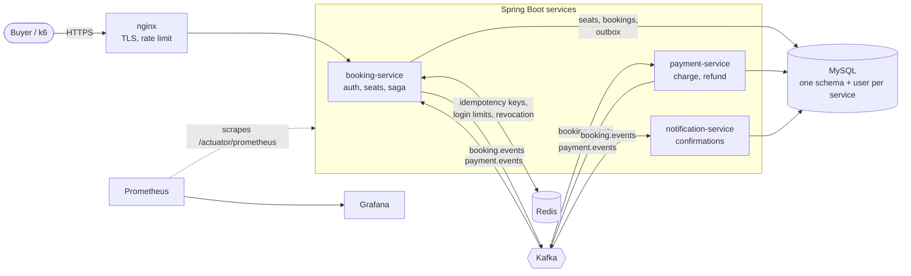
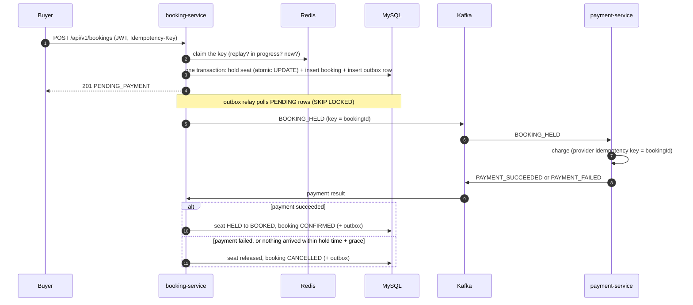

# Flash-Sale Booking Engine

A ticket-booking backend built for one moment: **thousands of buyers hit "book" in the same second for 100 seats, and exactly 100 of them win**. No oversell, no double charge, no seat stuck forever, and every claim in this file is backed by a test or a metric you can run.

Java 21 · Spring Boot 3.5 · MySQL 8.4 · Redis 7 · Kafka (KRaft) · Flyway · Docker · Kubernetes · GitHub Actions · AWS EC2 · Prometheus + Grafana

## What it guarantees

| Guarantee | How | Proven by |
|---|---|---|
| A seat is never sold twice | Atomic conditional `UPDATE` on the seat row, plus a unique index on active bookings as a backstop | `BookingConcurrencyTest`, `FlashSaleHttpConcurrencyTest` (250 buyers, 100 seats), k6 load test, alert on `flashsale_db_backstop_total` |
| A retried request never books twice | `Idempotency-Key`: Redis fast path, MySQL unique index `(user_id, key)` as the real guarantee | `IdempotencyIntegrationTest` (50 concurrent retries), retry-storm test |
| A paid booking is never lost, an unpaid one never holds a seat forever | Saga over Kafka with compensation, plus a timeout reaper | `PaymentSagaIntegrationTest`, `PendingBookingReaperTest` |
| No event is lost between the database and Kafka | Transactional outbox: the event is written in the same transaction as the state change, relayed afterwards | `OutboxRelayIntegrationTest`, `OutboxRelayTest` |
| A redelivered Kafka message has no second effect | Consumers de-duplicate on `event_id` in the same transaction as the side effect | `NotificationKafkaIntegrationTest` |
| Only the right people can do the right things | JWT (HS256) with USER/ADMIN roles, refresh-token rotation with reuse detection, logout revocation, login rate limiting | `SecurityWebTest`, `AuthFlowIntegrationTest`, `RefreshTokenServiceTest` |

## Architecture



Each service owns its own database schema and its own MySQL user, so a bug in one service physically cannot read another's tables. Services talk to each other only through Kafka events.

### One booking, end to end



## Quick start (Docker only, about 5 minutes)

Needs Docker Desktop, and `make` or the equivalent commands from the `Makefile`.

```bash
cp .env.example .env            # then replace every CHANGE_ME (JWT_SECRET needs 32+ characters)
make stack-up                   # MySQL, Redis, Kafka, 3 services, nginx; waits until all are healthy
make smoke                      # register, login, book, replay, saga confirms, logout; prints SMOKE TEST PASSED
make obs-up                     # adds Prometheus :9090 and Grafana :3000 (set GRAFANA_ADMIN_PASSWORD in .env first)
make stack-down
```

Without `make` (PowerShell): the exact compose commands are in `deploy/README.md`, and the smoke test is `powershell -ExecutionPolicy Bypass -File .\deploy\smoke-test.ps1`.

API through nginx at `http://localhost:8080`:

| Method and path | Who | Notes |
|---|---|---|
| `POST /api/v1/auth/register`, `/login`, `/refresh`, `/logout` | public (logout needs a token) | login is rate limited per user and IP |
| `GET /api/v1/events/{id}/availability` | public | seats available, held, booked |
| `POST /api/v1/bookings` | USER | header `Idempotency-Key` is required; body `{"eventId":1}` plus optional `"seatNumber"` |
| `GET /api/v1/bookings/{id}` | owner | |
| `POST /api/v1/bookings/{id}/cancel` | owner | releases the seat |
| `POST /api/v1/bookings/{id}/confirm` | ADMIN | manual override; normally the saga does this |

## Testing

```bash
mvn clean verify                # unit tests (JUnit 5, Mockito) + Testcontainers integration tests + 80% JaCoCo gate
```

Concurrency tests use real MySQL and Redis in Testcontainers, not mocks, because a mock cannot lose a race. The load test is k6:

```bash
make loadtest-reset && make loadtest     # 300 buyers, 100 seats, 20% double-click; see loadtest/README.md
```

**Load-test results** (k6: 300 buyers compete for 100 seats, about 20% of them double-click, plus 50 requests/s of browsing for 20 s; Windows laptop, 7.8 GB RAM, Docker Desktop, **everything on the same machine**: MySQL, Redis, Kafka, three services, nginx and k6 itself):

| DB pool | Sold (201) | Oversold | Book p95 | Availability p95 | Overload responses | `http_reqs` rate |
|---|---|---|---|---|---|---|
| 10 | 100 | 0 | 4.57 s | 2.91 s | 1 x 500 (pool timeout, before the 503 mapping existed) | 50.9/s |
| 20 | 100 | 0 | 4.13 s | 2.20 s | 5 x 503 `SERVICE_BUSY` | 47.5/s |

An earlier pool-20 run measured a book p95 of 3.07 s, so run-to-run spread on this machine is about as large as the difference between pool sizes; I do not claim a pool-size effect from these runs.

What these numbers do and do not show:
- **Correctness held under every run**: exactly 100 sold, 0 oversold, and the database ended with 100 seats held and none double-booked.
- **Latency is not good, and I say so.** The p95 latency thresholds in the script (1.5 s booking, 0.5 s availability) failed in both runs. 300 buyers hitting one laptop that is also running the whole stack and the load generator is CPU-bound; the requests queue for database connections and CPU rather than fail.
- **When the connection pool runs dry, the service sheds load instead of breaking.** A request that waits 3 s for a connection now gets `503 SERVICE_BUSY` with `Retry-After`, not a 500. In the pool-10 run that case was still a 500, which is why the mapping was added.
- **`http_reqs` rate is not a capacity number.** The browsing traffic is a fixed 50 requests/s, so the total is bounded by the test design. Buyers are the 300 one-shot requests.
- A fair capacity test needs the load generator on a separate machine, a multi-core database host and a warmed JVM. This table is a correctness-under-contention result, not a benchmark.

## Observability

`make obs-up`, then Grafana at <http://localhost:3000> (user `admin`), dashboard **Flash Sale Overview**.

- **Business metrics**: seats by status, booking attempts by outcome (`created`, `sold_out`, `seat_unavailable`, `replayed`, ...), payments and notifications by outcome, saga transitions.
- **Reliability metrics**: outbox backlog and age of the oldest unpublished event, Kafka consumer lag, reaper cancellations, database pool saturation, p50/p95/p99 booking latency, 5xx ratio.
- **Alerts** (`deploy/observability/alerts.yml`, validated in CI with `promtool`): the one that matters most is `DoubleBookingPrevented`. Its value should be exactly 0 forever; if it ever fires, an application lock was bypassed and the database's unique index caught it.
- Metrics are served on `/actuator/prometheus`. nginx and the Ingress route only `/api` and `/healthz`, and the smoke test asserts that the metrics endpoint is **not** reachable from outside.
- Logs are one JSON object per line (ECS format) with a correlation id.

Not included: Alertmanager (alerts show in the Prometheus UI, but nothing pages anyone) and tracing.

## Deployment

| Target | Where | Notes |
|---|---|---|
| Docker Compose | `deploy/` | infra, services, nginx; hardened containers (no capabilities, read-only filesystem) |
| Kubernetes (kind) | `deploy/k8s/` | kustomize, probes, HPA on booking-service, Ingress; secrets created from `.env`, never in git |
| AWS EC2 | `deploy/aws/` | one instance, real HTTPS (Let's Encrypt), no SSH (SSM Session Manager), config in SSM Parameter Store, backups to S3, optional deploy from CI through GitHub OIDC |
| CI | `.github/workflows/ci.yml` | build and test, validate Kubernetes manifests, nginx config and monitoring config, run the whole stack and the smoke test, publish images to GHCR |

## Design decisions and trade-offs

- **Atomic `UPDATE ... WHERE status = 'AVAILABLE'` as the default seat lock.** One round trip, no lock held while the application thinks. Pessimistic (`FOR UPDATE`) and optimistic strategies are implemented too and switchable by configuration, so the choice is measurable rather than asserted. Anonymous "any seat" requests use `FOR UPDATE SKIP LOCKED`, so concurrent buyers land on different rows instead of queueing on one.
- **Two layers for every guarantee.** Redis and the application lock are the fast path; a MySQL unique index is the real guarantee. If Redis is flushed or down, correctness holds and only speed suffers (the code fails open on purpose, and says so in logs).
- **Outbox instead of "write to MySQL, then send to Kafka".** Those two writes cannot be one transaction; the outbox turns "send" into a row that commits with the state change. Cost: at-least-once delivery, which is why consumers de-duplicate.
- **Saga instead of a distributed transaction.** Booking, payment and notification each commit locally and react to events; failure is handled by compensation (release the seat, refund), not by locking across services.
- **No database connection held across the payment-provider call.** A slow provider must not be able to exhaust the pool.

## Known limits (honest list)

- The outbox relay preserves per-booking order only with **one booking-service replica**. With several replicas, partition the relay by aggregate id.
- The payment provider is simulated; the integration contract (idempotency key = booking id, refund on late success) is real.
- A single EC2 instance is a single point of failure, and MySQL, Redis and Kafka run as containers. A production shape would use RDS, ElastiCache, MSK and a load balancer with two or more instances; the Kubernetes manifests show the scaled-out layout.
- A notification sent successfully whose database commit then fails is sent again on retry (at-least-once). A provider-side idempotency key would close this gap.

## The hardest problem I solved: three things racing for the same seat

Locking a seat against 300 simultaneous buyers turned out to be the easy half. The harder bug class appeared once payments existed, because **a seat now has three independent actors that can change its fate at almost the same moment**: the payment result arriving as "success", the payment result arriving as "failed", and the timeout reaper cancelling a booking whose payment seemed lost. Each runs in a different transaction, triggered by a different message or timer, with no shared memory.

The naive version checks the booking's status and then updates it. That check-then-act has a window: a cancel that raced a confirm could read `PENDING_PAYMENT`, lose the race, and still overwrite `CONFIRMED` with `CANCELLED`, and the customer who just paid loses the seat while the money is gone.

The fix was to stop treating the booking row as the arbiter and make **the seat's state transition the arbiter**. `confirm` is allowed only if `UPDATE seats SET status='BOOKED' WHERE id=? AND status='HELD'` changes exactly one row; `cancel` only if `... SET status='AVAILABLE' WHERE ... AND status='HELD'` does. Whichever transaction moves the seat out of `HELD` first wins, and the loser sees zero affected rows and aborts without touching the booking. The database serialises them; no application lock, no version counter, no sleep.

Two related details made it hold up in practice:
- **Idempotent steps everywhere.** Confirming a confirmed booking, or cancelling a cancelled one, is a no-op, so Kafka redelivery and double-clicking users cannot cause a second effect.
- **The grace period.** The reaper waits for hold time plus 30 seconds, so a payment that lands right at the deadline still wins the race fairly. If the payment provider charges after the booking was cancelled, the payment service notices (its own conditional update affects zero rows) and refunds immediately.

What I would want a reviewer to take from this: concurrency bugs live in gaps between a read and a write, and the robust fix is to collapse the gap into one atomic statement the database arbitrates, then prove it with a test that actually races real transactions against a real database.

## Repository layout

```
common/                 shared events, error model, auto-configuration
booking-service/        auth, seats, bookings, outbox relay, saga consumer, timeout reaper
payment-service/        payment consumer, simulated gateway, refunds, outbox
notification-service/   idempotent consumer with retry topics and a dead-letter topic
deploy/                 compose files, nginx, Kubernetes, AWS scripts, Prometheus and Grafana
loadtest/               k6 script, seed reset, runbook
.github/workflows/      CI
```
